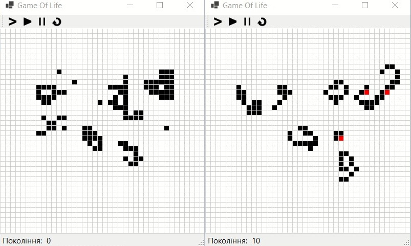

<h1>Комп'ютерні ситсеми імітаційного моделювання</h1>

<h2>СПм-25-2 Чертіщева Ксенія Ігорівна</br>
Домашнє завдання</h2>

<i>Варіант: Клітинний автомат с трьома станами</br>
Реалізація застосунка (на браузерном JavaScript або C#/WinForms/WPF), який ілюструє роботу клітинного автомату. На відміну від звичайної гри "Життя", де клітина може мати тільки два стану - існує або ні - у цьому завданні передбачається наявність третього стану. Його сенс можна обрати на власний розсуд і узгодити. Як варіант - у якості третього стану використовувати лічильник поколінь, тобто ввести імітацію "старіння" клітини, з відповідним доповненням правил симуляції.
</i>

Для внесення модифікацій до клітинного автомату спочатку необхідно реалізувати базову логіку гри "Життя". Програма буде написана мовою c#, інтерфейс програми буде реалізований завдяки бібліотеці WinForms. Cтворимо клас cell, котрий буде описувати логіку роботи клітин, в ньому задамо новий клас перечислення - стани клітини.

```
        private enum State
        {
            Alive,
            Dead
        }
```

Додамо до класу два поля, одне з котрий буде зберігати стан клітини в цьому поколінні, а друге - стан в наступному. 

```
        private State cellState;
        private State nextgenerationCellStage;
```

Переходячи саме до реалізації логіки програми, створимо функцію, котра буде визначати та виставляти стан клітини в наступному поколінні. На вхід функція приймає кількість живих сусідів клітини та під час виконання на основі цієї змінної, а також нинішнього стану клітини, надає значення полю <i>nextgenerationCellStage</i>.

```
        public void generationalStateChange(int numOfAliveNeighbors)
        {
            switch (cellState)
            {
                case State.Alive:

                    if (numOfAliveNeighbors < 2)                  // помирає від недонаселеності
                        nextgenerationCellStage = State.Dead;
                    else if (numOfAliveNeighbors == 2)            // живе до наступного покоління
                        nextgenerationCellStage = State.Alive;    
                    else if (numOfAliveNeighbors == 3)            // живе до наступного покоління
                        nextgenerationCellStage = State.Alive;    
                    else                                          // 4 чи більше сусіда- > dies of overpopulation
                        nextgenerationCellStage = State.Dead;

                    break;
                case State.Dead:

                    if (numOfAliveNeighbors < 2)                  // залишається мертвою
                        nextgenerationCellStage = State.Dead;
                    else if (numOfAliveNeighbors == 2)            // залишається мертвою
                        nextgenerationCellStage = State.Dead;
                    else if (numOfAliveNeighbors == 3)            // стає живою
                        nextgenerationCellStage = State.Alive;
                    else                                          // залишається мертвою
                        nextgenerationCellStage = State.Dead;

                    break;
            }
            }
```

Для переходу до нового покоління нинішній стан клітини, тобто <i>cellState</i> , приймає розраховане значення <i>nextgenerationCellStage</i>. Опишемо цю логіку в окремій функції:

```
        public void switchToNewGeneration()
        {
            cellState = nextgenerationCellStage;
        }
```

Маючи базову структуру, можна вносити бажані модифікації.</br>
Новий стан клітини: Стабільна(спляча)
При знаходженні в сприятливих умовах, коли кількість сусідів є 2 чи 3, жива клітина може перейти до стану стабільної. В стані стабільності клітина не зважає на своє оточення та не може померти від недонаселення чи перенаселення, інші клітини сприймають стабільну клітину як живу. Клітина знаходиться в стані стабільності допоки в неї є на це ресурси, ресурс клітини визначається як кількість живих сусідів, коли клітина увійшла до стану сплячки - 1, на кожному поколінні клітина втрачає одиницю свого ресурсу.</br>
Оновимо клітинний автомат. додавши до нього логіку третього стану. Додамо стан до перечислення:

```
        private enum State
        {
            Alive,
            Dead,
            Stable
        }
```

Для реалізації необхідно додати два нових поля до класу: перше це константна змінна, що визначає вірогідність з якою клітина може стати стабільно, а друге це лічильник ресурсів клітини.

```
        const double STABLE_CHANCE = 0.95;
        private int stableTimer;
```

Необхідно змінити функцію розрахунку стану клітини. Увійти до стану стабільності клітина може тільки зі стану живої при значеннях сусідів 2 та 3, знаходячись у стані стабільної клітина не приймає рішень як їй змінюватися в це покоління, а тільки витрачає свій ресурс. Відобразимо ці зміни у функції <i>generationalStateChange</i>, розрахунок шансу клітини стати стабільної перенесемо до функції <i>stableChance</i>.
```
        public void generationalStateChange(int numOfAliveNeighbors)
        {
            switch (cellState)
            {
                case State.Alive:

                    if (numOfAliveNeighbors < 2)                  // помирає від недонаселеності
                        nextgenerationCellStage = State.Dead;
                    else if (numOfAliveNeighbors == 2)            // живе до наступного покоління
                        nextgenerationCellStage = stableChance(numOfAliveNeighbors); //State.Alive;
                    else if (numOfAliveNeighbors == 3)            // живе до наступного покоління
                        nextgenerationCellStage = stableChance(numOfAliveNeighbors); //State.Alive;
                    else                                          // 4 чи більше сусіда- > dies of overpopulation
                        nextgenerationCellStage = State.Dead;

                    break;
                case State.Dead:

                    if (numOfAliveNeighbors < 2)                  // залишається мертвою
                        nextgenerationCellStage = State.Dead;
                    else if (numOfAliveNeighbors == 2)            // залишається мертвою
                        nextgenerationCellStage = State.Dead;
                    else if (numOfAliveNeighbors == 3)            // стає живою
                        nextgenerationCellStage = State.Alive;
                    else                                          // залишається мертвою
                        nextgenerationCellStage = State.Dead;

                    break;

                case State.Stable:
                    if (stableTimer-- <= 0)
                        nextgenerationCellStage = State.Alive;
                    break;
            }
        }
```

Опишемо логіку <i>stableChance</i>:

```
        private State stableChance(int numOfAliveNeighbors)
        {
            if (rand.NextDouble() >= STABLE_CHANCE){
                stableTimer = numOfAliveNeighbors - 1;
                return State.Stable;
            }
            return cellState;
        }
```

Робота клітинного автомату в програмі реалізується завдяки створенню масиву описаного класу cell.

```
  private Cell[,] matrixOfCells;
```

Інтерфейс програми складається з простих елементів бібліотеки WinForms: поле гри є пустим зображенням, котре створюється під час виконання, керування тактами відбувається завдяки строчці інструментів, а до строки статусу виводиться лічильник поколінь. В програмі чорні клітини є живими, білі є мертвими, а стабільні є червоними. Інтерфейс програми має вигляд:


