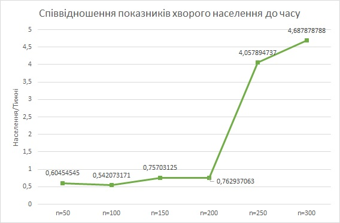
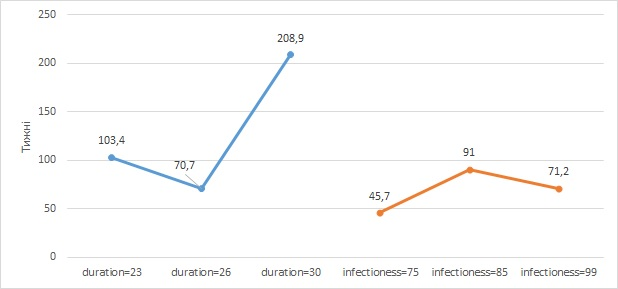

<h1>Комп'ютерні ситсеми імітаційного моделювання</h1>

<h2>СПм-25-2 Чертіщева Ксенія Ігорівна 
Лабораторна робота №1</h2>

<i>Варіант 3, модель у середовищі NetLogo:  
[Virus](https://www.netlogoweb.org/launch#https://www.netlogoweb.org/assets/modelslib/Sample%20Models/Biology/Virus.nlogo)
</i>

<h4>Вербальний опис модель</h4>
Завдяки моделі відбувається симуляція життя і розповсюдження вірусної інфекції в деякій популяції. Черепахами в моделі є люди, вони можуть перебувати в трьох різних станах:

* Здоровий
* Хворий
* Має імунітет

Усі стани пов'язані між собою, людина зазвичай (не рахуючи всіх агентів, що мають стан "хворий" на 0 циклі моделювання), починає з першого стану "здоровий" після контактування з хворою людиною, агент з деякою вірогідністю може перейти до стану "хворий", після деякого часу перебування в стані хворий людина має шанс чи померти і зникнути з симуляції, чи залишитися і перейти до стану "має імунітет", після сплину деякого періоду часу особа з імунітетом втрачає його і переходить назад до стану "здоровий".
Популяція людей не є статичною, вона може зменшуватися шляхом вимирання агентів від хвороби чи старості та збільшуватись за допомоги розмоноження здорових агентів.

Круючі параметри:
* number-people - параметр відповідає не тільки за наглядну кількість об'єктів(людей) в симуляції, а ще й виконує роль показника щільності населення;
* infectioness - параметр визначає заразність хвороби, тобто яка міра контакту між хворою і здоровою людиною повинна відбутися для того, щоб хвороба передалась;
* chance-recover - параметр визначає шанс, з котрим людина переживе захворювання і отримає імунітет;
* duration - параметр визначає час, скільки людина буде хворіти, по сплину визначеного часу людина чи помирає, чи отримує імунітет.

Внутрішні параметри:
*  Lifespam - кількість часу, після котрого особа помирає від природньої смерті(на відміну від смерті від захворювання);
*  Carrying capacity - максимальне значення агентів у симуляції;
*  Duration of imunity - кількість часу, коли людина буде знаходитися в стані "має імунітет";
*  Birth-rate - шанс, з котрим кожен з об'єктів в симуляції може розмножитися за один цикл.

Показники роботи системи: 
Показниками роботи системи є значення популяції та співвідношення агентів за типами їх здоров'я. Після прогону моделі результат подається як значення кількості здорових, хворих, перехворівших, а також загального показника населення за кожен тиждень симуляції. 

Примітки 
При абсолютно всіх моделюваннях початкова кількість хворих є 10.

Недоліки 
Модель значно спрощує як і симулювання популяції, так і симулювання життя вірусу. 
Популяція моделі є доволі спрощеною, індивідууми не мають ніяких унікальних характеристик, котрі б відрізняли їх одне від одного, що в свою чергу унеможливлює більш комплексу симуляцію поширення хвороби. Об'єкти в симуляції не можуть розрізнятися за їх віком, імунітетом, способом життя та подібним, що зазвичай має вплив на поширення та життя хвороби. Об'єкти в симуляції не прагнуть зберегти свій стан здоров'я, модель не передбачає мір запобігання захворюваності такі як ізоляція чи вакцинація. 
Хвороба в моделюванні також має свої неточності, вірус не має різних стадій, в котрі він по-різному впливає на носія та на оточення та не здатен повноцінно мутувати. 

<h4>Обчислювальні експерименти</h4>

1. Вплив щільності початкової популяції на поширення хвороби в ній.

Опис експерименту:  
Досліджується залежність динаміки захворюваності від розміру початкової популяції.
Статичними змінними в експерименті є infectioness, chance-recover та duration, що будуть мати свої стандартні значення в 65%, 75% та 20 тижнів відповідно.
Динамічною змінною в експерименті є number-people, значенням котрої є деяке число n де n ∈ N = {50, 100, 150, 200, 250, 300}.
Збір даних відбувається протягом 5 років (260 тижнів), з кожною варіацією відбувається 10 прогонів моделі.
Збирається інформація про: максимальне досягнуте значення хворих агентів, тиждень на котрому значення було досягнуто. 

Результати експерименту:
Після проведення всіх експериментів, результати було поєднано до одного файлу, для кожного значення було розраховано його середнє число за тижнем. Відредаговані дані було оформлено у вигляді графіків, таблиці з результатами доступні в додатках.

Складемо таблицю до котрої занесемо максимальне досягнуте значення хворих та тиждень, коли значення було досягнуто. Оскільки два параметри не можна порівняти напряму чи графічно чи графічно оскільки вони вирівнюються в різних мірах - люди та тижні, то поділимо їх тим самим утворюючи нову міру співвідношення показників. 

| | 50 | 100 | 150 | 200 | 250 | 300|
|-|----|-----|-----|-----|-----|----|
|Максимальне значення хворих| 12,09.. |	88,9 |	96,9 |	109,1 |	154,2 |	154,7 |
|Такт досягання максимуму| 20 |	164 |	128 |	143 |	38 |	33 |
|Співвідношення показників| 0,60454545 |	0,542073171 |	0,75703125 |	0,762937063 |	4,057894737 |	4,687878788 |

З графіку можна побачити як починаючи з показника в кількість населення n = 250 епідемічна ситуація врази погіршується, максимальна кількість хворих була великою та досягнула максимуму швидко, що призвело до великих показників співвідношення.  

2. Перевірка більш впливового фактору вірусу при низькій популяції: infectioness та duration

Опис експерименту:  
При низькій популяцій населення поширення вірусу значно сповільнюється, в експерименті буде перевірено який з параметрів є більш важливим для виживання вірусу у вказаних умовах - шанс здорової людини захворіти при контакті з хворим чи кількість часу, котрий хворий буде перебувати в цьому стані.
Статичними змінними в експерименті є кількість населення number-people значення котрого є 50, а також chance-recover не змінить значення з 75%.
Збір даних відбувається протягом 5 років (260 тижнів), з кожною варіацією відбувається 10 прогонів моделі.

0) Контрольний експеримент:
Для дослідження стандартної динаміки захворюваності в невеликій популяції людей було проведено симуляцію, в котрій обидва параметри залишаються статичними, тобто infectioness = 65%, duration = 20 тижнів.

Результати експерименту:

1) Перевірка впливу infectioness:
Додаткова статична змінна - duration = 20 тижнів.
Динамічною змінною в експерименті є infectioness, значенням котрої є деяке число n де n ∈ N = { 75, 85, 99}.

Результати експерименту:

2) Перевірка впливу duration:
Додаткова статична змінна - infectioness = 65%.
Динамічною змінною в експерименті є duration, значенням котрої є деяке число n де n ∈ N = { 23, 26, 30}

Результати експерименту:

| |Частина виживання вірусу|
|-|-------------------------|
|infectioness = 75| 0/10 |
|infectioness = 85| 2/10 |
|infectioness = 99| 0/10 |
|duration = 23| 2/10 |
|duration = 26| 0/10|
|duration = 30| 8/10 |

Таблиця середнього значення такту зникнення захворювання:

|duration=23 | duration=26 | duration=30 |	infectioness=75 |	infectioness=85 |	infectioness=99 |
|------------|-------------|-------------|------------------|-----------------|-----------------|
|103,4 | 70,7 | 208,9 |	45,7 |	91 |	71,2 |

Як можна побачити з результатів, більш важливою змінною для виживання вірусу в невеликій популяції людей є час його перебігу, а не заразніть. Обидва значення поступово було збільшено приблизно в 1,5 рази від стандартного результати проведення експерименту 1 показали, що динаміка захворюваності при збільшенні infectioness майже не відрізняється від контрольного експерименту. При збільшенні duration, спочатку результати виглядають так само як і контрольний експеримент, проте при встановленні значення в 30 можна побачити як динаміка різко змінюється і вірус виживає до 5-х років набагато частіше, ніж у минулих випадках.

3. Залежність виживання вірусу від його смертності

При великих показниках смертності від захворювання виникає ситуація при котрій всі носії хвороби вимирають до того, як передати захворювання здоровій людині, що унеможливлює подальші захворювання.
Статичними змінними в експерименті є infectioness, number-people та duration, що будуть мати свої стандартні значення в 65%, 150 осіб та 20 тижнів відповідно.
Динамічною змінною в експерименті є chance-recover, значенням котрої є деяке число n де n ∈ N = {0, 5 , 10, 15, 20, 25, 30, 35, 40, 45, 50}.
Збір даних відбувається чи до того часу, поки в симуляції присутні хворі агенти, чи до природньої смерті першого покоління агентів - 50 років(2600 тижнів), з кожною варіацією відбувається 20 прогонів моделі.

Результати експерименту:

| chance-recover | months |
|----------------|--------|
|0| 219,9 |
|5| 331,15 |
|10| 524,45 |
|15| 433,35 |
|20| 783,35 |
|25| 1277,6 |
|30| 1736,05 |
|35| 2264,1 |
|40| 2242,45 |
|45| 2415,6 |
|50| 2600 |

З результатів експерименту видно, що загальною тенденцією є зростання кількості тижнів виживання вірусу зі збільшенням шансу пережити захворювання, проте оцінюючи результати від точки до точки, можна побачити різницю в значеннях.
По-перше: можна побачити, що приріст в період з 15% до 35% є значно більший ніж в інші періоди, 
По-друге: приріст не є стабільним і може коливатись в сторону спадання в періоди невеликого приросту між точками, значення вимірювання 15% та 40% є меншими за попередні точки.
