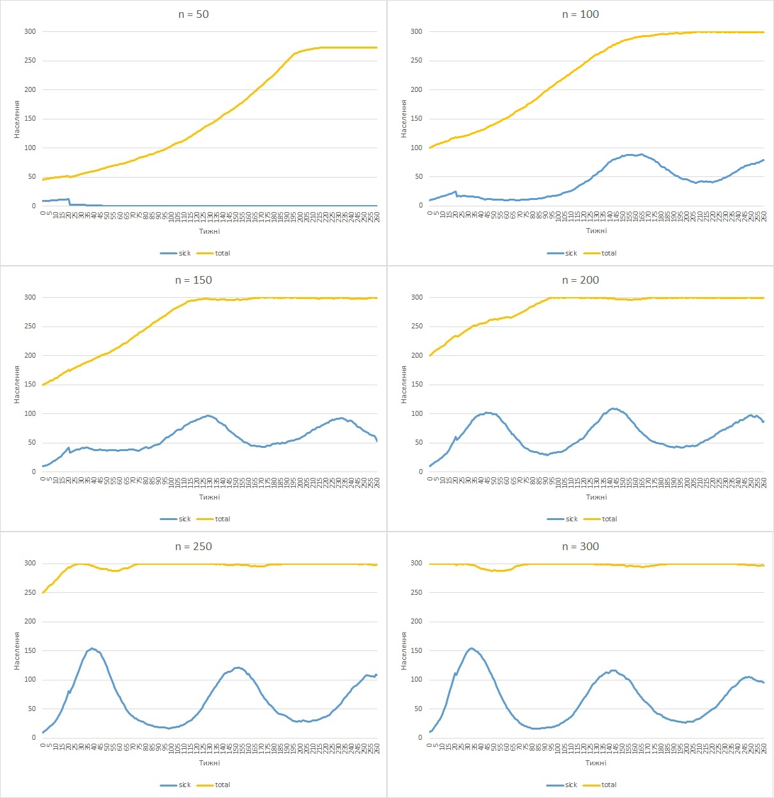
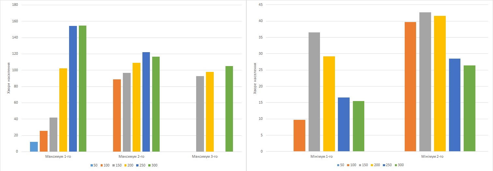
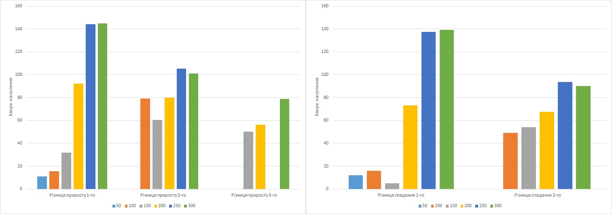
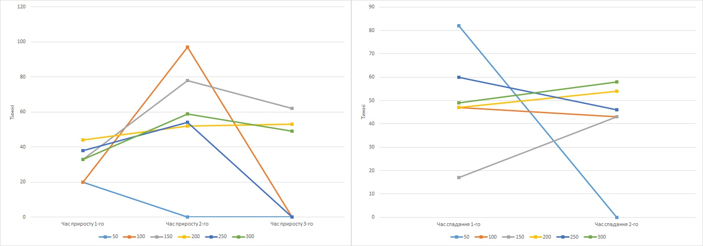
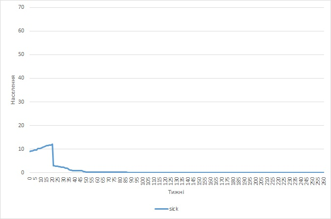
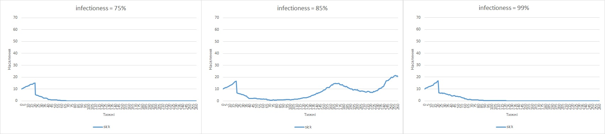
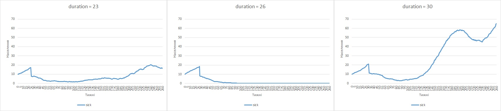
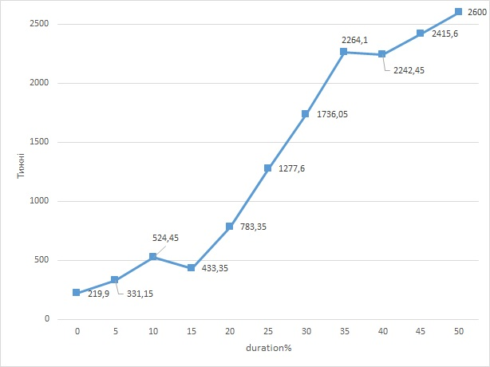

<h1>Комп'ютерні ситсеми імітаційного моделювання</h1>

<h2>СПм-25-2 Чертіщева Ксенія Ігорівна 
Лабораторна робота №1</h2>

<i>Варіант 3, модель у середовищі NetLogo:  
[Virus](https://www.netlogoweb.org/launch#https://www.netlogoweb.org/assets/modelslib/Sample%20Models/Biology/Virus.nlogo)
</i>

<h4>Вербальний опис модель</h4>
Завдяки моделі відбувається симуляція життя і розповсюдження вірусної інфекції в деякій популяції людей. Черепахами в моделі є люди, вони можуть перебувати в трьох різних станах:

* Здоровий
* Хворий
* Має імунітет

Усі стани пов'язані між собою, людина зазвичай (не рахуючи всі об'єкти, що мають стан "хворий" на 0 циклі моделювання), починає зі першого стану "здоровий" після контактування з хворою людиною, агент з деякою вірогідністю може перейти до стану "хворий", після деякого часу перебування в стані хворий людина має шанс чи померти і зникнути з симуляції, чи залишитися і перейти до стану "має імунітет", після сплину деякого періоду часу особа з імунітетом втрачає його і переходить назад до стану "здоровий".
Популяція людей не є статичною, вона може зменшуватися шляхом вимирання агентів від хвороби чи старості та збільшуватись за допомоги розмоноження здорових агентів.

Круючі параметри:
* number-people - параметр відповідає не тільки за наглядну кількість об'єктів(людей) в симуляції, а ще й виконує роль показника щільності населення;
* infectioness - параметр визначає заразність хвороби, тобто яка міра контакту між хворою і здоровою людиною повинна відбутися для того, щоб хвороба передалась;
* chance-recover - параметр визначає шанс, з котрим людина переживе захворювання і отримає імунітет;
* duration - параметр визначає час, скільки людина буде хворіти, по сплину визначеного часу людина чи помирає, чи отримує імунітет.

Внутрішні параметри:
*  Lifespam - кількість часу, після котрого особа помирає від природньої смерті(на відміну від смерті від захворювання);
*  Carrying capacity - максимальне значення агентів у симуляції;
*  Duration of imunity - кількість часу, коли людина буде знаходитися в стані "має імунітет";
*  Birth-rate - шанс, з котрим кожен з об'єктів в симуляції може розмножитися за один цикл.

Показники роботи системи: 
Основні результати роботи системи пов'язанні з популяцією та розподілом типів людей у ній. Після прогону моделі, результат виглядає як значення загальної кількості людей в популяції, числові та відсотків данні щодо кількості здорових, хворих та людей, що мають імунітет. Також всі дані доступні в динаміці, тобто перегляд інформації відбувається не тільки за останній цикл виконання, а і за ті, що були до нього.

Примітки 
При абсолютно всіх моделюваннях початкова кількість хворих є 10.

Недоліки 
Модель значно спрощує як і симулювання популяції, так і симулювання життя вірусу. 
Популяція моделі є доволі спрощеною, індивідууми не мають ніяких унікальних характеристик, котрі б відрізняли їх одне від одного, що в свою чергу унеможливлює більш комплексу симуляцію поширення хвороби. Об'єкти в симуляції не можуть розрізнятися за їх віком, імунітетом, способом життя та подібним, що зазвичай має вплив на поширення та життя хвороби. Об'єкти в симуляції не прагнуть зберегти свій стан здоров'я, модель не передбачає мір запобігання захворюваності такі як ізоляція чи вакцинація. 
Хвороба в моделюванні також має свої неточності, вірус на має різних стадій, в котрі він по-різному впливає на носія та на оточення та не здатен повноцінно мутувати. 

<h4>Обчислювальні експерименти</h4>

1. Вплив щільності початкової популяції на динаміку захворюваності населення.

Опис експерименту:  
Досліджується залежність приросту та спадання та загальної кількості хворого населення від розміру початкової популяції.
Статичними змінними в експерименті є infectioness, chance-recover та duration, що будуть мати свої стандартні значення в 65%, 75% та 20 тижнів відповідно.
Динамічною змінною в експерименті є number-people, значенням котрої є деяке число n де n ∈ N = {50, 100, 150, 200, 250, 300}.
Збір даних відбувається протягом 5 років (260 тижнів), з кожною варіацією відбувається 10 прогонів моделі.

Результати експерименту:
Після проведення всіх експериментів, результати було поєднано до одного файлу, для кожного значення було розраховано його середнє число за тижнем. Відредаговані дані було оформлено у вигляді графіків, таблиці з результатами доступні в додатках.

З проведених експериментів можна побачити загальну динаміку захворюваності населення, а саме як показник хворих агентів коливається хвилями, досягаючи локальних піків захворюваності та потім спадає. Визначимо пік захворюваності як момент в котрий загальна динаміка хворого населення змінюється з зростання на спадання.  
Також з експериментів можна побачити ще один, практичний мінус моделі: точно визначений час протікання хвороби впливає на результати моделювання на перших циклах симуляції. В тиждень, котрий відповідає встановленому значенню duration, кількість хворих спадає неймовірно стрімко. Це відбувається через те, що в перших 10 хворих агентів спливає час хвороби і цим утворює нетипову для моделі динаміку.  
Для оцінки динаміки створимо таблицю, в котру занесемо: кількість піків захворюваності, максимальне досягнуте та мінімальне значення після спаду захворюваності, різницю хворих на початку та кінці приросту/спадання, а також період приросту та спадання (час в тижнях за котрий після досягнення одного локального екстремуму графік досяг протилежного екстремуму).

|   | 50 | 100 | 150 | 200 | 250 | 300 |
|---|----|-----|-----|-----|-----|-----|
|Кількість піків| 1 | 2 | 3 | 3 | 2 | 3 |
|Мінімум 0-го| 10 | 10 | 10 | 10 | 10 | 10 |
|Максимум 1-го| 12,09090909 | 25,7 | 41,7 | 102,3 | 154,2 | 154,7 |
|Мінімум 1-го| -- | 9,7 | 36,6 | 29,2 | 16,6 | 15,5 |
|Максимум 2-го| -- | 88,9 | 96,9 | 109,1 | 122 | 116,5 |
|Мінімум 2-го| -- | 39,7 | 42,7 | 41,6 | 28,5 | 26,4 |
|Максимум 3-го| -- | -- | 92,8 | 97,9 | -- | 105,1 |
|Різниця приросту 1-го| 11,09090909 | 15,7 | 31,7 | 92,3 | 144,2 | 144,7 |
|Різниця спадання 1-го| 12,09090909 | 16 | 5,1 | 73,1 | 137,6 | 139,2 |
|Різниця приросту 2-го| -- | 79,2 | 60,3 | 79,9 | 105,4 | 101 |
|Різниця спадання 2-го| -- | 49,2 | 54,2 | 67,5 | 93,5 | 90,1 |
|Різниця приросту 3-го| -- | -- | 50,1 | 56,3 | -- | 78,7 |
|Час приросту 1-го| 20 | 20 | 33 | 44 | 38 | 33 |
|Час спадання 1-го| 82 | 47 | 17 | 47 | 60 | 49 |
|Час приросту 2-го| -- | 97 | 78 | 52 | 54 | 59 |
|Час спадання 2-го| -- | 43 | 43 | 54 | 46 | 58 |
|Час приросту 3-го| -- | -- | 62 | 53 | -- | 49 |

Розподіливши кожну з категорій таблиці на максимум/мінімум оформимо графіки:

* Кількість хворого населення під час піків та анти-піків:

З гістограм можна зробити висновок що кількість хворих під час першого піку напряму залежить від популяції, при нижчих значеннях хворіє менша частка населення, при більших - більша. Проте починаючи з другого піку і продовжуючи в подальші, кількість хворих вирівнюється приблизно до одного й того самого рівня.

Гістограми різниці між максимальними та мінімальними значеннями показують такі самі тренди, прирости та спадання хворої частки населення стають більшими при менших значеннях та навпаки

* Час на досягнення піку захворюваності і на спадання хвороби до мінімуму

Динаміка приросту показує деякий тренд між різними піками, оскільки при всіх експериментах на досягнення другого піку завжди пішло більше часу, ніж на перший, для значень n 150 та 300 час знову опустився. Значення n 200 показало найбільш стабільний результат часу зростання між всіма трьома піками.  
Розглядаючи час досягнення максимуму в межах одного піку, точну динаміку вивести не можливо.

Динаміка спадання хвороби від піку до мінімуму є доволі хаотичною, в ній не можна побачити ніякої чіткої залежності результатів від змінних.

2. Перевірка більш впливового фактору вірусу при низькій популяції: infectioness та duration

Опис експерименту:  
При низькій популяцій населення поширення вірусу значно сповільнюється, в експерименті буде перевірено який з параметрів є більш важливим для виживання вірусу у вказаних умовах - шанс здорової людини захворіти при контакті з хворим чи кількість часу, котрий хворий буде перебувати в цьому стані.
Статичними змінними в експерименті є кількість населення number-people значення котрого є 50, а також chance-recover не змінить значення з 75%.
Збір даних відбувається протягом 5 років (260 тижнів), з кожною варіацією відбувається 10 прогонів моделі.

0) Контрольний експеримент:
Для дослідження стандартної динаміки захворюваності в невеликій популяції людей було проведено симуляцію, в котрій обидва параметри залишаються статичними, тобто infectioness = 65%, duration = 20 тижнів.

Результати експерименту:

1) Перевірка впливу infectioness:
Додаткова статична змінна - duration = 20 тижнів.
Динамічною змінною в експерименті є infectioness, значенням котрої є деяке число n де n ∈ N = { 75, 85, 99}.

Результати експерименту:

2) Перевірка впливу duration:
Додаткова статична змінна - infectioness = 65%.
Динамічною змінною в експерименті є duration, значенням котрої є деяке число n де n ∈ N = { 23, 26, 30}

Результати експерименту:

Як можна побачити з результатів, більш важливою змінною для виживання вірусу в невеликій популяції людей є час його перебігу, а не заразніть. Обидва значення поступово було збільшено приблизно в 1,5 рази від стандартного результати проведення експерименту 1 показали, що динаміка захворюваності при збільшенні infectioness майже не відрізняється від контрольного експерименту. При збільшенні duration, спочатку результати виглядають так само як і контрольний експеримент, проте при встановленні значення в 30 можна побачити як динаміка різко змінюється і вірус виживає до 5-х років набагато частіше, ніж у минулих випадках.

3. Залежність виживання вірусу від його смертності
При великих показниках смертності від захворювання виникає ситуація при котрій всі носії хвороби вимирають до того, як передати захворювання здоровій людині, що унеможливлює подальші захворювання.
Статичними змінними в експерименті є infectioness, number-people та duration, що будуть мати свої стандартні значення в 65%, 150 осіб та 20 тижнів відповідно.
Динамічною змінною в експерименті є chance-recover, значенням котрої є деяке число n де n ∈ N = {0, 5 , 10, 15, 20, 25, 30, 35, 40, 45, 50}.
Збір даних відбувається чи до того часу, поки в симуляції присутні хворі агенти, чи до природньої смерті першого покоління агентів - 50 років(2600 тижнів), з кожною варіацією відбувається 20 прогонів моделі.

Результати експерименту:

| chance-recover | months |
|----------------|--------|
|0| 219,9 |
|5| 331,15 |
|10| 524,45 |
|15| 433,35 |
|20| 783,35 |
|25| 1277,6 |
|30| 1736,05 |
|35| 2264,1 |
|40| 2242,45 |
|45| 2415,6 |
|50| 2600 |

З результатів експерименту видно, що загальною тенденцією є зростання кількості тижнів виживання вірусу зі збільшенням шансу пережити захворювання, проте оцінюючи результати від точки до точки, можна побачити різницю в значеннях.
По-перше: можна побачити, що приріст в період з 15% до 35% є значно більший ніж в інші періоди, 
По-друге: приріст не є стабільним і може коливатись в сторону спадання в періоди невеликого приросту між точками, значення вимірювання 15% та 40% є меншими за попередні точки.
