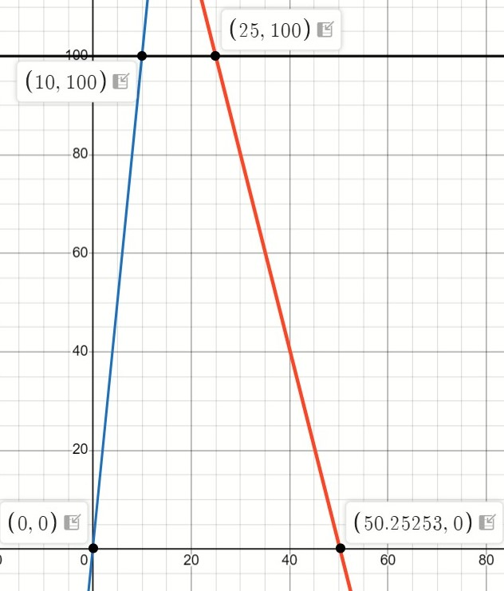
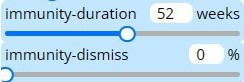
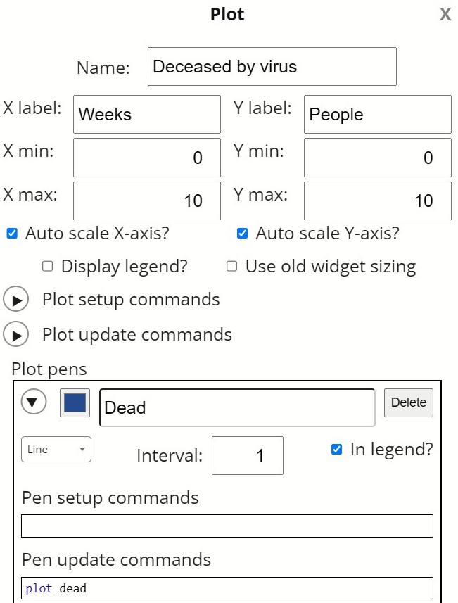
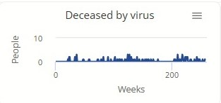
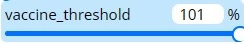
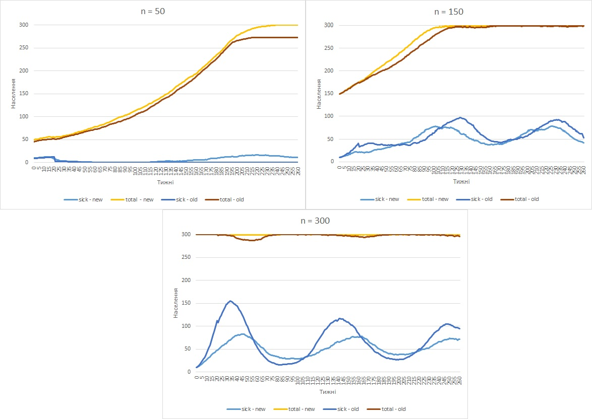
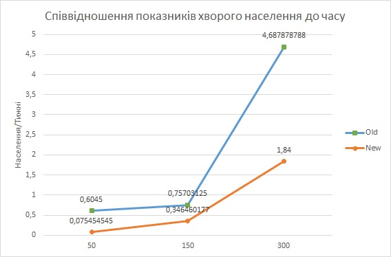

<h1>Комп'ютерні ситсеми імітаційного моделювання</h1>

<h2>СПм-25-2 Чертіщева Ксенія Ігорівна</br>
Лабораторна робота №2</h2>

<i>Варіант 3, модель у середовищі NetLogo: </br>
[Virus](https://www.netlogoweb.org/launch#https://www.netlogoweb.org/assets/modelslib/Sample%20Models/Biology/Virus.nlogo)
</i>

<h4>Внесення змін до коду відносно варіанту</h4>

1. Додати вплив віку на інфікування та результат захворювання.

Модель вже зберігає всю необхідну інформацію для введення нового функціоналу, тому для його реалізації необхідно тільки написати новий код. Подивимося функції програми, котрі відповідають за логіку, що нас цікавить.

Функція результату захворювання:
```
to recover-or-die ;; turtle procedure
  if sick-time > duration                        ;; If the turtle has survived past the virus' duration, then
    [ ifelse random-float 100 < chance-recover   ;; either recover or die
      [ become-immune ]
      [ die ] ]
end
```
Функція інфікування:
```
to infect ;; turtle procedure
  ask other turtles-here with [ not sick? and not immune? ]
    [ if random-float 100 < infectiousness
      [ get-sick ] ]
end
```

Важливим для нас моментом є генерація шансів подій та перевірка проходження їх через встановлений в моделі поріг. Для додавання впливу інших факторів необхідно вести зміни саме в цих строках, є декілька шляхів, котрими можна би було їх змінити. Автор моделі використав ```random-float```  для генерації шансу, ця функція видає випадкові значення з рівномірним розподілом, а її єдиним параметром є максимальне значення для генерації. Для виконання завдання скористаємося функцією ```random-normal```, що генерує числа з нормальним розподілом, функція приймає два аргументи - mean та standard deviation, відповідно до двох параметрів самого нормального розподілу. В нашому випадку дисперсія буде сталим значенням, а завдяки мат. очікуванню буде відбуватися корегування отримуваних значень відносно віку. Оскільки функція повинна видавати особливий тип значень, а саме вірогідність, то додатково необхідно ввести перевірку на знаходження в правильному інтервалі { 0 <= x <= 100}.</br>
Для роботи функції генерації додатково необхідно додати функцію знаходження значення мат. сподівання, оскільки "значення" стану імунної системи людини(її шанс залишитися здоровою/пережити хворобу) не є звичайним лінійним зростанням чи спаданням. Зважаючи на те, що агенти в моделі мають час життя в 50 років, визначмо основні динаміки стану імунної системи:
* агент починає життя з неймовірно слабким імунітетом;
* стан імунітету агенту швидко зростає до досягання 10 років;
* З 10 до 25 стан імунітету агенту є незмінно високим;
* З 26 років(включно) до смерті в 50 років стану імунітету повільно спадає; 
* В 50 агент знову має неймовірно низький імунітет.

Для пришвидшення розрахунків, опишемо логіку покращення-погіршення імунної системи агенту трьома прямими:



Створимо дві функції: перша буде визначати яке значення повинен прийняти модифікатор віку, а друга буде саме видавати випадкове число. 
```
to-report age_modif [_m]
  let modif 1
  ifelse age <= (10 * 52) [set modif (( (age / 52) * _m ) / 10) ][
    ifelse age <= (25 * 52) [ set modif _m]
    [ set modif ((( ( (age / 52) - 50) / -25) * (_m - 1)) + 1) ]
  ]
  report modif
end

to-report age_based_chance [_m]
  let modif age_modif _m
  let chance random-normal modif 30
  if chance < 0 [ set chance 0]
  if chance > 100 [ set chance 100]
  report chance
end
```

Маючи готову функцію генерації випадкових чисел, поміняємо всі ```random-float``` на нашу кастомну функцію ```age_based_chance``` :

Функція результату захворювання:
```
to recover-or-die ;; turtle procedure
  if sick-time > duration                        ;; If the turtle has survived past the virus' duration, then
    [ ifelse age_based_chance 100 < chance-recover   ;; either recover or die
      [ become-immune ]
      [ die ] ]
end
```
Функція інфікування:
```
to infect ;; turtle procedure
  ask other turtles-here with [ not sick? and not immune? ]
    [ if age_based_chance 100 < infectiousness
      [ get-sick ] ]
end
```

2. Додати вплив ступеня поширення захворювання (поточного відсотка інфікованих) на вірогідність появи нових агентів.

Логіка появи нових агентів обробляється в функції  ```reproduce```, котра викликається на кожному циклі моделювання для всіх здорових агентів.
```
to reproduce
  if count turtles < carrying-capacity and random-float 100 < chance-reproduce
    [ hatch 1
      [ set age 1
        lt 45 fd 1
        get-healthy ] ]
end
```

Для того щоб ввести вплив поширення хвороби на народжуваність необхідно, по-перше, знати відсоток хворого населення, а по-друге, мати можливість вплинути на вірогідність появи агентів при досягненні певного порогу. Кількість інфікованих агентів на кожному циклі вже є відомою і зберігається зберігається в змінній ```%infected```, проте, механізму впливу на показник народжуваності нема. Для цього створимо ще одну глобальну змінну - ```chance-reproduce_mult``` , та нехай змінна поводиться за правилами:
* Перед початком моделювання змінна приймає значення 1 - не має ніякого впливу на народжуваність;
* При роботі моделі на кожному циклі перевіряється значення ```%infected```:
  * Якщо ```%infected``` >= 80 , то ```chance-reproduce_mult``` приймає значення 2 - агенти розмножують з вдвічі меншою вірогідністю;
  * Якщо ```%infected``` < 80 , то ```chance-reproduce_mult``` приймає повертається до значення 1.

Задаємо початкове значення нової змінної в функції ```setup```:
```
set chance-reproduce_mult 1
```

Створюємо логіку зміни значення змінної на кожному циклі моделювання в функції ```go```:
```
  ifelse %infected >= 80  [ set chance-reproduce_mult 2 ] 
  [set chance-reproduce_mult 1]
```

Додавши нову змінну до стандартної функції отримаємо:

```
to reproduce
  if count turtles < carrying-capacity and random-float 100 < (chance-reproduce / chance-reproduce_mult)
    [   hatch 1
      	[ set age 1
        	lt 45 fd 1
        	get-healthy ]]
end
```

3. Додати можливість регулювання тривалості імунітету та вірогідності захворіти повторно.

В цьому завданні необхідно внести зміни не тільки до логіки програми, а і до інтерфейсу, тому розблокуємо інтерфейс та додамо до нього два нових повзунка: один для існуючої змінної ```immunity-duration ```, а другий для нової ```immunity-dismiss```. 



Для того, щоб при роботі програми не виникало помилок, всі означення змінної ```immunity-duration``` необхідно закоментувати (а саме її означення в ```go``` та ```globals```). Для того, щоб агенти могли використовувати ```immunity-dismiss``` необхідно ще раз змінити згадану в першому завданні функцію ```infect```. 

```
to infect ;; turtle procedure
  ask other turtles-here with [ not sick? and not immune? ]
    [ if age_based_chance 100 < infectiousness
      [ get-sick ] ]
end
```

Створимо нову локальну змінну ```not_dissmised```, якщо вона буде приймати значення false, то імунітет агенту буде проігноровано, на початку функції наддамо їй значення true, тобто імунітет поки НЕ ігнорується. Далі прибраємо другу частину першого if блоку(після and включно), так щоб до нього могли потрапляти агенти з імунітетом. Створюємо новий if блок ціллю котрого є задання фінального значення новій локальній змінній, спочатку перевіряємо чи має агент імунітет, якщо так, то далі йде ще один if блок, де ```not_dissmised``` може прийняти значення false. Останнім кроком додаємо результат до логічного блоку перевірки чи захворює агент. Поєднавши всі зміни отримуємо:

```
to infect ;; turtle procedure
  let not_dissmised true
  ask other turtles-here with [ not sick? ]  ;; and not immune? ]
    [ 
      if immune? [ 
        if random-float 100 > immunity-dismiss [
        	set not_dissmised false
        ]
      ]
      
      if not_dissmised and age_based_chance age < infectiousness
      	[ get-sick ]
     ]
end
```

<h4>Внесення власних змін</h4>

1. Зміна логіки смерті агентів
   
Великою проблемою при зборі даних в лабораторній роботі №1 було те, що перші 10 агентів одночасно переходили з стану "хворий" на циклі, що дорівнював ```duration```. Відбувається це через те, що в моделі абсолютно всі агенти хворіють і помирають/виліковуються за один і той самий період часу, що не відповідає природньому прототипу. Внесемо зміни до логіки роботи моделі так щоб кожен з агентів мав свій унікальний час хвороби, для цього додамо новий параметр до черепах ```death_offset```, в котрому і буде зберігатися інформація. Логіку часу хвороби агентів можна описати як:
* Кожен з агентів хворіє як мінімум час, котрий дорівнює половині ```duration```, d* = duration/2 ;
* В кожного агенту є свій унікальний ```death_offset```, котрий віднімає чи додає час до хвороби;
* Час ```death_offset``` є випадковим, він може приймати додатне чи від'ємне значення;
* ```death_offset``` приймає значення в інтервалі \[ -d*/2,  d*/2 \]

Працювати з ```death_offset``` необхідно в двох випадках: при створенні агентів та в функції смерті. 
Агенти створюють в двох місцях, перед початком моделювання в функції ```setup-turtles``` та потім під час моделювання в функції ```reproduce```. До кожної з цих функцій в блок створення черепах додамо нову команду, що задає значення нашої змінної:
```
set death_offset ((random ((duration / 2) + 1)) - ((duration / 2) / 2))
```

Повертаємося до функції ```recover-or-die``` , де тепер до першого if блоку додаємо значення ```death_offset ``` до ```duration```.

```
to recover-or-die ;; turtle procedure
  if sick-time > duration + death_offset             ;; If the turtle has survived past the virus' duration, then
    [ ifelse age_based_chance 100 < chance-recover   ;; either recover or die
      [ become-immune ]
    [  die  ]  ]
end
```

2. Додавання графіку смертності від хвороби за тижні

В оригінальній моделі результат подається як співвідношення хворих/здорових/з імунітетом часток населення, що є важливою інформацією, проте інколи дослідження може потребувати іншого роду інформації. В нашому випадку, введемо лічильників смертності, графік та відповідну таблицю, котрі будуть показувати скільки агентів померло на певному тижні.
1) Почнемо з вводу глобальної змінної ```dead```, в ній буде зберігатися інформації що нас цікавить. 
2) В функції ```setup``` виставляємо значення ```dead``` в 0 оскільки це початок програми.
3) Нас цікавить тільки смертність від хвороби, тому додаємо ```set dead (dead + 1)``` в вже редаговану ```recover-or-die``` перед викликом самої ```die```.
4) Оскільки розраховується значення померлих тільки на цьому циклі, а не за весь час, перезапускаємо лічильник додавши ```set dead 0``` на початку ```go```.

Відкриваємо інтерфейс для редагування, обираємо створити новий графік даємо йому ім'я "Deceased by virus", підписуємо oX як Weeks(Тижні) як oY People(Люди), додаємо нову лінію на графік, називаємо її Dead та як команду оновлення задаємо ```plot dead```.



Графік під час моделювання:



3. Вакцинація агентів

Агенти в симуляції вже можуть протистояти вірусній інфекції завдяки декільком механізмам, а саме силі власної імунної системи дорослих людей та придбаному після хвороби імунітету. Проте для підтримки здоров'я популяції можна ще додати отримання імунітету до вірусу без перенесення самої хвороби шляхом вакцинації. Для реалізації вакцинації в моделі необхідно створити нову поведінкову функцію агентів, котра буде виконуватися на кожному циклі як і функція ходіння, старіння чи захворювання, а також для неї необхідно ввести новий параметр, котрий було вирішено вивести на інтерфейс. 
Розблокуємо інтерфейс та додамо новий слайдер, дамо йому назву ```vaccine_threshold```, це буде і ім'я відповідної змінної. Нова змінна може приймати значення від 0% до 101%, де 0%  - населення вакцинується навіть без хворих, а 101% - населення не буде вакцинуватися ніколи. 



Опишемо логіку нової функції: 
* Агенти зацікавлені в вакцинації коли кількість хворих в популяції перевищує встановлений поріг;
* Хворі агенти не зацікавлені в вакцинації;
* Агенти з імунітетом не зацікавлені в вакцинації;
* Тільки половина зацікавлених агентів дійсно пройдуть вакцинацію.

Виходячи з описаної логіки, напишемо відповідну функцію ```vaccinate```
```
to vaccinate
  if vaccine_threshold <= %infected and not sick? and not immune? [
    if random 2 = 1 [
    	become-immune
    ]
  ]
end
```

Для того, щоб агенти могли приймати рішення про вакцинацію, відповідну функцію необхідно додати до блоку ```ask turtles``` в ```go```, щоб рішення мало сенс, виклик функції повинен відбуватися до інфікування.

<h4>Проведення експерименту</h4>

Проведемо експеримент схожий до експерименту 1 з лабораторної роботи №1, подивимось на динаміку захворюваності в перші 5 років при n = 50, 150, 300 та порівняємо з минулими результатами.




Порівнюючи результати можна побачити, що всі значення стали менш екстремальними, тобто захворюваність не підіймається до великих значень, як в першій лабораторній і не спадає до таких низьких. При значенні n = 50 хвороба тепер змогла вижити до 5 року, утворюючи цим 2 пік. Заміна логіки часу смерті/виздоровлення агентів призвела до того, що присутній раніше скачок хворих на 20 тиждень тепер є відсутнім.

Складемо таблицю максимуму/часу та їх співвідношення
0,075454545	0,346460177	1,84

| | 50(old) | 50(new) | 150(old) | 150(new) | 300(old) | 300(new) |
|-|----|-----|-----|-----|-----|----| 
|Максимальне значення хворих| 12,09.. |	16,6 |	96,9 |	78,3 |	154,7 | 82,8|
|Такт досягання максимуму| 20 |	220 |	128 |	226 |	33 | 45|
|Співвідношення показників| 0,60454545 | 1,84 |	0,75703125 | 0,346460177 |	4,687878788 |0,075454545 |



Як можна побачити, нова модель симулює набагато менш критичну епідемічну ситуацію при високих показниках населення, проте зменшення показнику також можна побачити і при нижчих n.
