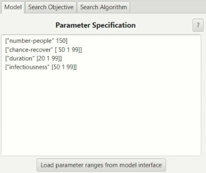
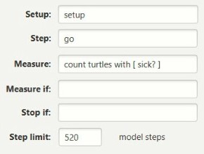
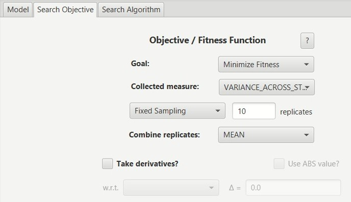
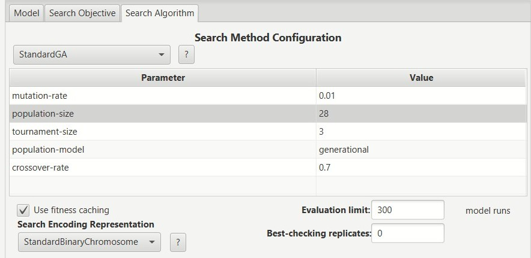
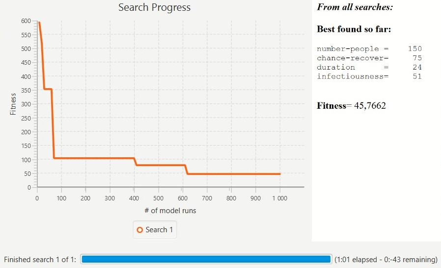
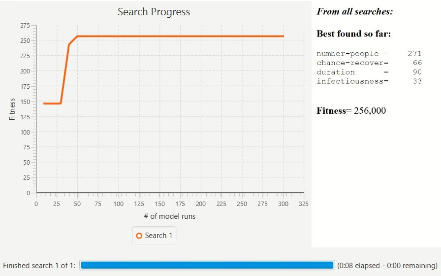

<h1>Комп'ютерні ситсеми імітаційного моделювання</h1>

<h2>СПм-25-2 Чертіщева Ксенія Ігорівна 
Лабораторна робота №3</h2>

<i>Варіант 3, модель Virus</i>

<h4>Робота в середовищі BehaviorSearch</h4>
1. Керуючі параметри

Скористаємося функцією автоматичного підвантаження керуючих параметрів моделі. 
Програма сприймає візуальний параметр ["turtle-shape" як один з керуючих, тому видалимо його. 
Виставимо так, що параметр number-people міг йти від 10 до 300.

2. Показник ефективності та налаштування цільової функції

Мірою оптимізації є кількість хворого населення, модель зберігає інформацію про стан агентів, тому для отримання значення можна підрахувати черепах . 
Ніяких додаткових механізмів зупинки чи вимірювання не передбачено 
Вимірювання відбувається впродовж 5 років тобто 260 тижні(кроків).

Перейдемо до налаштування цільової функції. Алгоритм буде намагатися знайти таку варіацію параметрів, при котрій кількість інфікованих людей на останньому циклі симуляції (тобто на 260) буде максимальною. 

3. Параметри алгоритму пошуку

При підборі параметрів такі факти були виведені:
* Найбільше всього на цільову функцію впливав показник популяцій;
  * В нашому випадку показник популяції в 28 дав найкращий результат;
* Звичайна бінарна хромосома дає результат кращий за всі інші;
* Заміна інших показників не дає кращого результату.

random seed = 2072442240

З виведених фактів параметри пошуку мають вигляд:

Результат пошуку:

Результат випадкового пошуку:

<h4>Робота з отриманими результатами</h4>

Протестуємо результати пошуку BehaviorSearch, їх відповідність та корректність.

Вхідні значення генетичного алгоритму:

number-people = 234;   
chance-recover = 97;   
duration = 87;   
infectiousness = 66;   

Вхідні значення випадкового алгоритму:

number-people = 271;   
chance-recover = 66;   
duration = 90;   
infectiousness = 33;   

Запустимо модель 10 разів для кожного з вхідних наборів параметрів, кількість хворих агентів на 260 циклі занесімо в таблицю:

| | 1 |	2 |	3 |	4 |	5 |	6 |	7 |	8 |	9 |	10 |	Cереднє |
|-|---|---|---|---|---|---|---|---|---|---|----------|
| GA |	269 |	269 |	281 |	258 |	273 |	269 |	269 |	274 |	290 |	257 |	270,9 |
| Random |	260 |	248 |	251 |	258 |	247 |	256 |	259 |	254 |	255 |	257 |	254,5 |
