<h1>Комп'ютерні ситсеми імітаційного моделювання</h1>

<h2>СПм-25-2 Чертіщева Ксенія Ігорівна 
Лабораторна робота №4</h2>

<i>Варіант 1</i>

<h4>Загальне завдання</h4>

1. Додавання агенту до модуляції

Перейдемо до вкладки мобільних роботів, знайдемо необхідну модель у списку всіх доступних об'єктів та перетягнемо її до середовища симуляції.
Запуск та керування симуляцією відбувається завдяки відповідним кнопкам на верхній панелі програми.
Маніпуляція над розташуванням та кутом повороту об'єкту відбувається завдяки інструментам та відповідним їм вікнам "Item Translation" та "Item Rotation".
Керувати звичайною камерою перегляду сцени можна завдяки мишки.

2. Додавання перешкоди

Поставимо перед доданим апаратом перешкоду, запустимо симуляції та прослідкуємо за її виконанням.

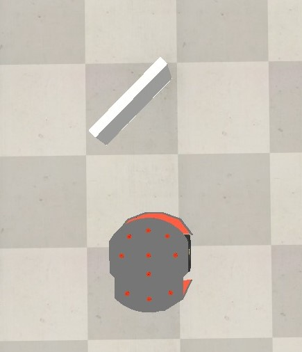
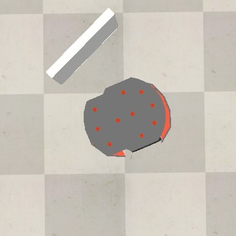

Як і було очікувано, машина відреагувала на перешкоду та повернула відповідно до напряму стінки.

3. Додавання камери

Додамо до сцени камеру, помістимо її в 3D симуляцію всередину робота, так щоб вона трохи виглядала з передньої сторони його корпусу. В ієрархії об'єктів помістимо її просто у розділ PioneerP3DX. 

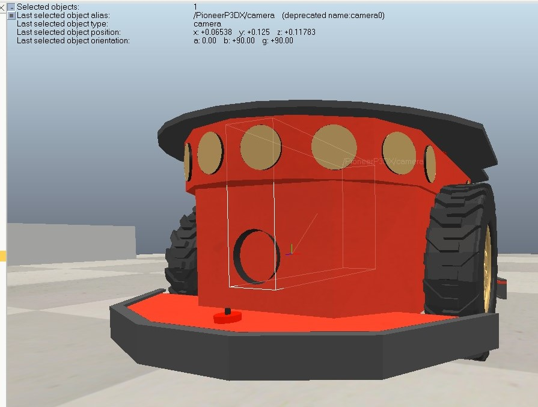
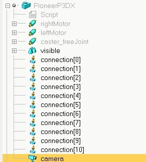

Між основною та нововстановленою на апарат камерою вже можна переключатися, проте щоб бачити постійно вид з камери робота створимо новий екран і підв'яжемо до нього "трансляцію" з необхідної камери.

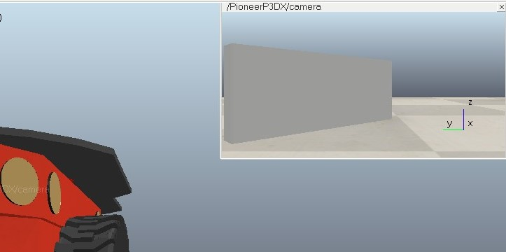

<h4>Завдання згідно варіанту</h4>
Завдання варіанту 1: Модифікація вихідного коду таким чином, щоб при зустрічі з перешкодою робот повератав ліворуч (увага на алгоритм Брайтенбергу та відповідні набори значень у коді). Додати на сцену випадковий набір із п'яти перешкод, розташувавши їх відповідно до руху робота.  
Представлений в роботі апарат розраховує свій шлях при зустрічі з перешкодою за допомоги алгоритму Брайтенбергу. Цей алгоритм використовує інформацію отриману з сенсорів на n циклі, стандартну швидкість робота та масив статичних значень для алгоритму (braitenbergL/R) для розрахунку дій на n+1 циклі, шляхом передання певної нової швидкості на мотори апарату.  
Функція sysCall_actuation викликається на кожному такті симуляції, в ній постійно відбувається перевірка активації сенсорів та реакція на відповідну активацію. Пристрій має 16 сенсорів, на кожному такті симуляції перевіряється чи сенсор фіксує перешкоду на вагомій дистанції та заповнюється масив коефіцієнтів detect. Розрахувавши реакцію сенсорів починається розрахунок нових значень швидкостей, беруться стандартні значення швидкості і до них поступово додаються помножені між собою значення масивів detect та braitenbergL/R. Останнім кроком нова швидкість передається на відповідні мотори.   
Для того щоб вплинути на логіку вибору напряму повороту агенту, занулимо всі значення що зберігаються в масиві braitenbergR, роблячи швидкість правого мотору статичною. Після зміни апарат, навіть при наявності наявності найбільш прямих шляхів при повороті праворуч, все одно буде обирати повертати ліворуч.

Додамо нові перешкоди до симуяції, за допомоги котрих можна буде і переглянути нову логіку.

Нові перешкоди і приблизний шлях проходження:

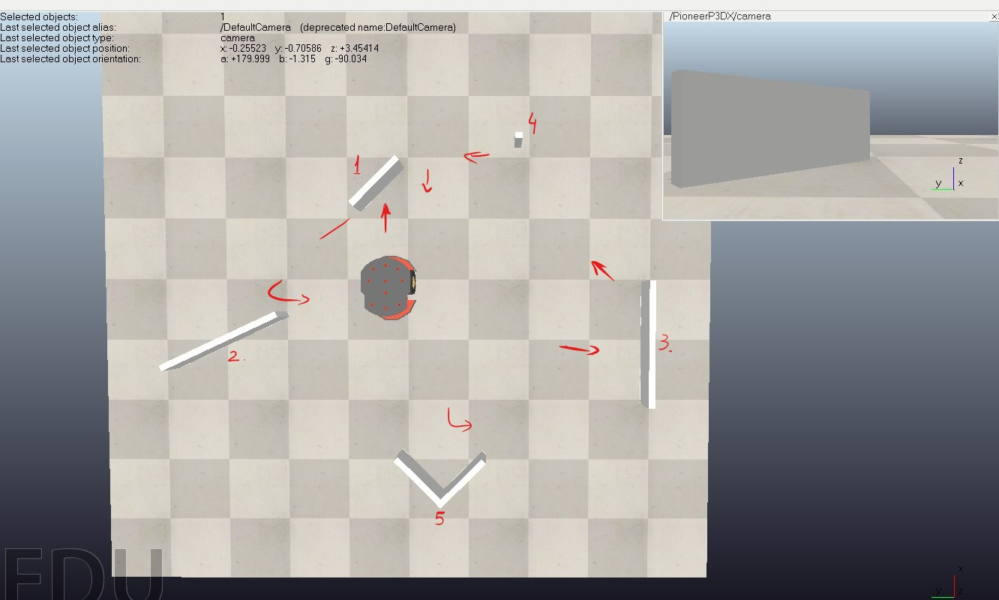

Моменти проходження:
1) Поворот ліворуч, коли раніше було обрано поворот праворуч.

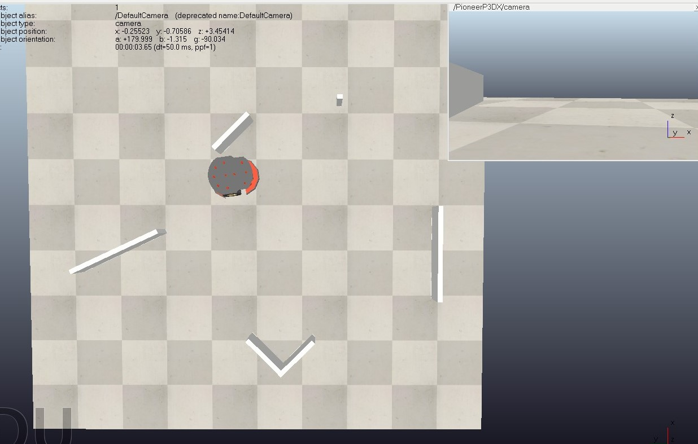

2) Апарат в процесі пороту ліворуч під гострим кутом.

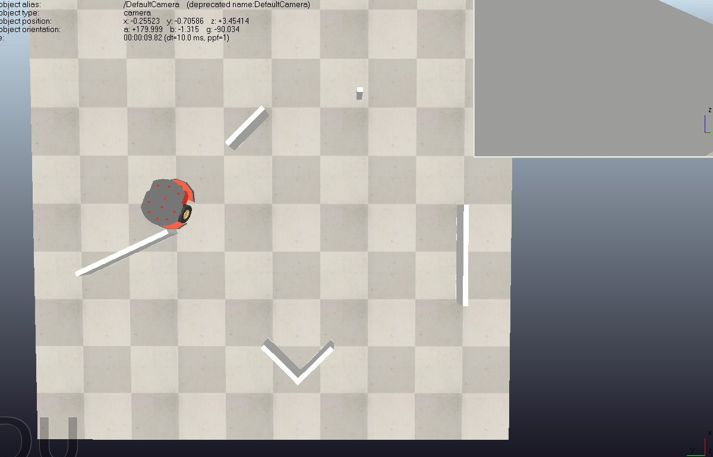

3) Поворот від прямої поверхні.

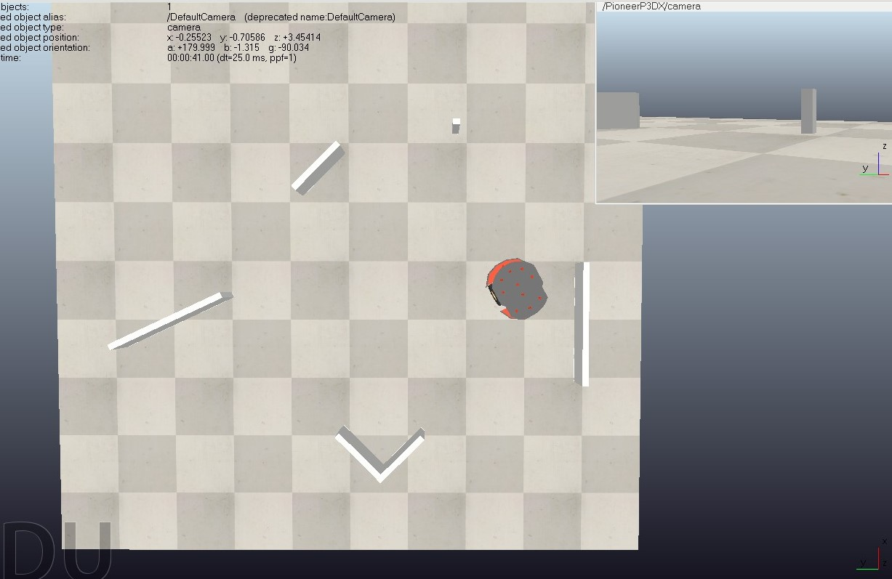

4) Зміна курсу ліворуч від невеликої перешкоди.

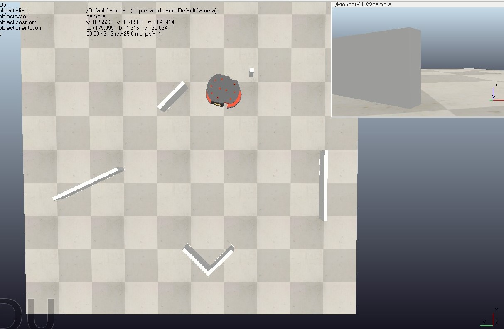

5) Поворот ліворуч від кута

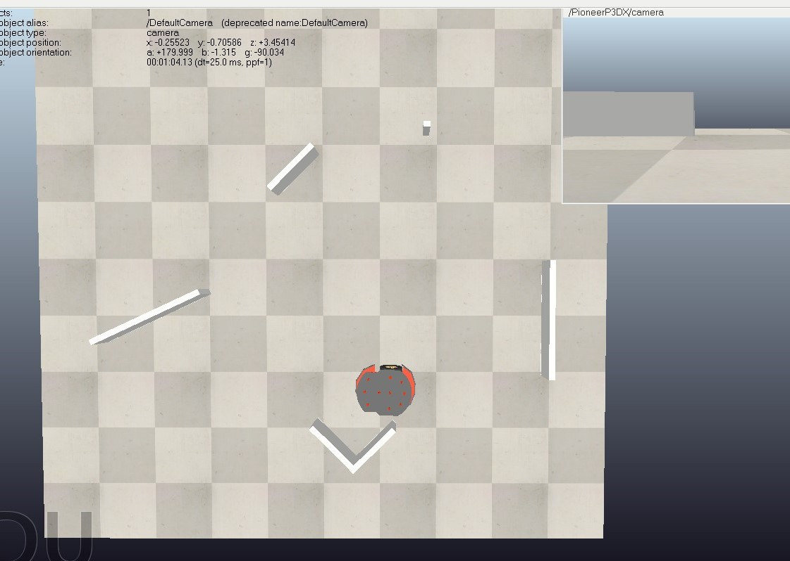
